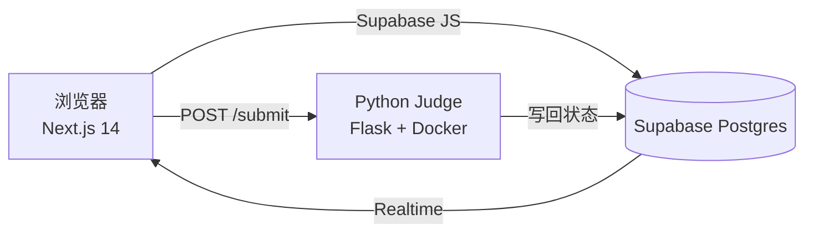
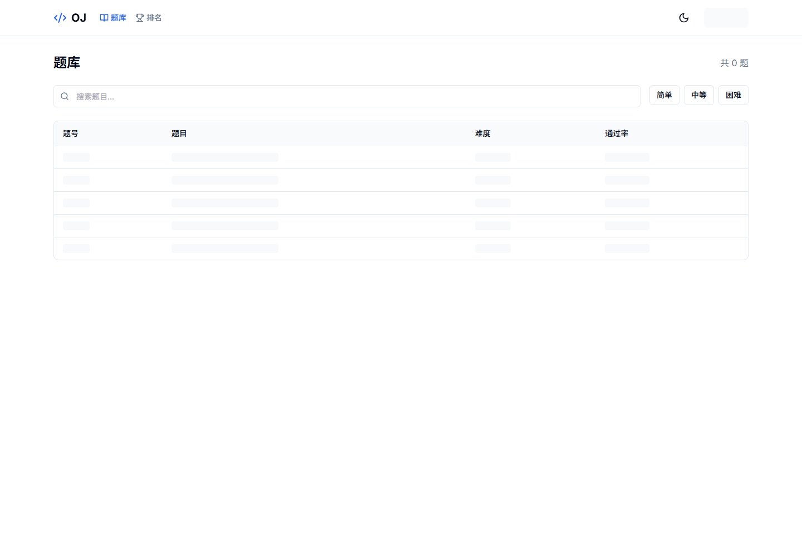

# Online Judge

> 一个可部署的在线判题系统：Next.js 14 前端 + Supabase 数据库/实时订阅 + Python 评测机。支持题目浏览、Monaco 代码编辑器、C++/Python 提交、实时评测状态、提交历史、排行榜。


---

## 功能

- 题目列表：搜索、难度筛选、标签
- 题目详情：Markdown / KaTeX 渲染、样例输入输出
- 代码编辑器：Monaco Editor，C++ / Python
- 代码提交：调用独立评测机编译运行，逐测试点判题
- 实时状态：pending → judging → accepted / wrong_answer / TLE / MLE / RE / CE
- 提交历史：状态、耗时、内存、代码
- 用户中心 / 排行榜
- 数据库初始化 SQL 与增量迁移脚本
- 评测机可独立 Docker 部署

---

## 架构



```text
online-judge/
├── frontend/       # Next.js 14 App Router + Tailwind + Monaco
├── judge/          # Python Flask 评测机 + Dockerfile
├── database/       # Supabase 初始化/迁移 SQL
├── .env.example    # 环境变量模板（无真实密钥）
├── README.md
└── LICENSE
```

---

## 本地启动

### 1. 环境要求

- Node.js **18+**
- Python **3.11+**（评测机）
- 一个 Supabase 项目（或兼容 Postgres + Realtime）

### 2. 配置环境变量

```bash
cp .env.example frontend/.env.local
```

编辑 `frontend/.env.local`：

```env
NEXT_PUBLIC_SUPABASE_URL=https://YOUR_PROJECT.supabase.co
NEXT_PUBLIC_SUPABASE_ANON_KEY=YOUR_ANON_KEY
SUPABASE_SERVICE_ROLE_KEY=YOUR_SERVICE_ROLE_KEY
NEXT_PUBLIC_SITE_URL=http://localhost:3000
JUDGE_SERVER_URL=http://localhost:7860
```

> 仓库不包含任何真实 Supabase key；`SUPABASE_SERVICE_ROLE_KEY` 只能放在服务端环境变量中，不能暴露给浏览器。

### 3. 初始化数据库

在 Supabase SQL Editor 中按顺序执行：

```text
database/init.sql
database/migration.sql
```

会创建 `profiles`、`problems`、`submissions` 等表及示例题目。

### 4. 启动前端

```bash
cd frontend
npm install
npm run dev
```

打开 <http://localhost:3000>。

### 5. 启动评测机

```bash
cd judge
pip install flask supabase
python judge_server.py
```

默认监听 `7860`，接口：

- `GET /health`：健康检查
- `POST /submit`：提交代码并评测

也可以用 Docker：

```bash
cd judge
docker build -t online-judge .
docker run -p 7860:7860 --env-file ../.env online-judge
```

---

## 评测机说明

- 支持语言：**C++17**、**Python 3**
- 编译超时 30s，单测试点运行超时/内存限制可配置
- 每个测试点独立临时目录，运行结束清理
- 状态写回 Supabase `submissions` 表，前端通过 Realtime 订阅
- 评测机容器内安装 `g++`、`gcc`、`python3`

---

## 测试与检查

```bash
# 前端类型检查 / 构建
cd frontend
npm run lint
npm run build

# 评测机健康检查
cd judge
python -m py_compile judge_server.py
python judge_server.py &
curl http://localhost:7860/health
```

手工验收：

- [ ] 首页题目列表、搜索、难度筛选
- [ ] 题目详情 Markdown/公式渲染
- [ ] 登录/注册
- [ ] 提交 C++ 正确代码 → accepted
- [ ] 提交错误代码 → wrong_answer
- [ ] 提交死循环 → TLE
- [ ] 提交语法错误 → compile_error
- [ ] 提交历史/排行榜

---

## 部署建议

| 部分 | 推荐平台 |
|---|---|
| 前端 | Vercel |
| 数据库/实时 | Supabase |
| 评测机 | Hugging Face Spaces (Docker) / 任意容器平台 |

部署时只配置环境变量，不要把 `.env.local` 或 `SUPABASE_SERVICE_ROLE_KEY` 提交到仓库。

---

## 安全说明

- 本仓库已移除原始 `.env.local` 与真实 key，只保留 `.env.example`。
- 评测机执行不可信代码，务必使用隔离容器、非 root 用户、资源限制与网络隔离。
- 生产环境请为提交接口增加鉴权、限流与审计。

---

## License

MIT License，详见 [LICENSE](LICENSE)。



